<p align="center">
  
</p>

<h1 align="center">MediaCraft</h1>

<p align="center">
  <b>Filme und Serien in einer Anwendung.</b><br>
  Die Funktionen von Sonarr und Radarr in einem einzigen Container, mit mehreren Metadaten-Providern<br>
  und einem Indexer-Usage-Tracking, das deine Grab-Limits wirklich ernst nimmt.
</p>

<p align="center">
  <a href="https://github.com/gottschalkfelix4-source/mediacraft/actions/workflows/docker.yml"></a>
  <a href="https://github.com/gottschalkfelix4-source/mediacraft/pkgs/container/mediacraft"></a>
  
  
  
</p>

<p align="center">
  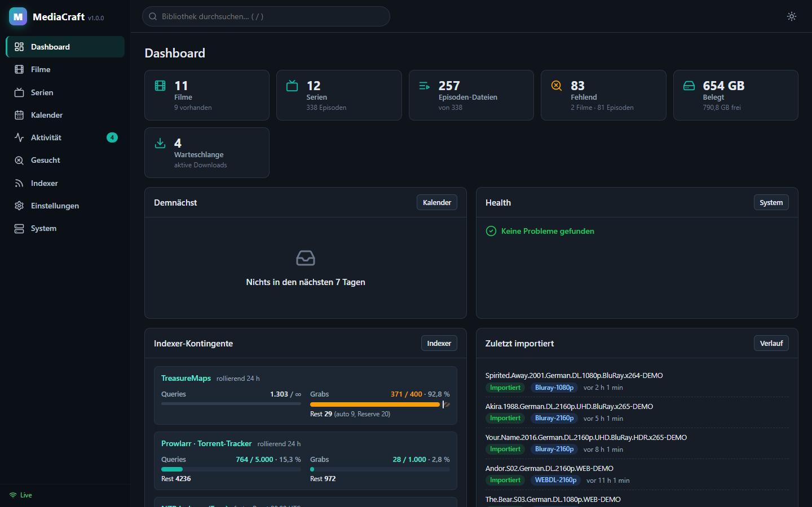
</p>

MediaCraft ist komplett neu geschrieben und enthält keinen Code aus den *arr-Projekten: Release-Parser,
Entscheidungs-Engine, Indexer-, Downloadclient- und Metadaten-Anbindungen sowie die Oberfläche.
Über eine Sonarr-/Radarr-kompatible API passt es trotzdem ohne Umbau in bestehende Stacks mit
Prowlarr, Jellyseerr/Overseerr und Homepage. Recherche und Architektur stehen in [ARCHITEKTUR.md](ARCHITEKTUR.md).

---

## Inhalt

- [Highlights](#highlights)
- [Screenshots](#screenshots)
- [Installation](#installation)
  - [Docker Compose](#docker-compose)
  - [Docker CLI](#docker-cli)
  - [Unraid](#unraid)
- [In einen bestehenden Mediastack integrieren](#in-einen-bestehenden-mediastack-integrieren)
- [Indexer-Limits einrichten](#indexer-limits-einrichten-beispiel-treasuremaps)
- [Konfiguration](#konfiguration)
- [Entwicklung](#entwicklung)

## Highlights

| Funktion | Kurz gesagt |
|---|---|
| 🎬📺 **Eine Bibliothek** | Filme, Serien und Anime in einer Datenbank. Profile, Indexer, Downloadclients, Tags und Root-Folder werden gemeinsam genutzt. |
| 🧩 **Mehrere Metadaten-Provider** | TMDB, TheTVDB v4, TVmaze, OMDb und AniList, mit Reihenfolge pro Medientyp und Fallback. |
| 📊 **Indexer-Usage-Tracking** | Query- und Grab-Limits pro Indexer, rollierend oder mit festem Reset, z. B. 400 Grabs / 24 h rollierend. Mit Reserve, Prognose und Historie. |
| 🇩🇪 **Deutsch zuerst** | Oberfläche auf Deutsch. Der Parser erkennt `German.DL`, `ML` und `Subbed`; Custom Formats wie *German DL* sind vorkonfiguriert. |
| 🔌 **Drop-in-kompatibel** | `/sonarr/api/v3` und `/radarr/api/v3` für Prowlarr-Sync, Jellyseerr/Overseerr und Homepage-Widgets. |
| 🐳 **Ein Container** | Ein Image für amd64 und arm64 mit PUID/PGID, Healthcheck und Unraid-Template. |
| 🧰 **Bazarr & Recyclarr** | Bazarr liest Dateien samt Tonspuren, Recyclarr pflegt Custom Formats, Profile und Qualitätsdefinitionen nach TRaSH. |
| 💾 **Backups** | Automatisch und von Hand, Wiederherstellung per Klick; vor jedem Datenbank-Update wird gesichert. |

<details>
<summary><b>Alle Funktionen anzeigen</b></summary>

- **Metadaten**
  - Die Suche fragt alle aktiven Provider parallel ab. Duplikate werden über Cross-IDs (tvdb/tmdb/imdb/tvmaze/anilist) zusammengeführt.
  - Fehlende Felder werden aus weiteren Providern ergänzt: deutsche Übersetzung, Poster, Ratings, Alternativtitel, exakte Ausstrahlungszeiten.
  - Ohne API-Key sofort nutzbar: **TVmaze** für Serien und **AniList** für Anime-Serien und -Filme.
  - Pro Serie ist wählbar, welcher Provider die Episodennummerierung vorgibt.
  - Ein Antwort-Cache in der Datenbank schont die API-Kontingente.
- **Indexer**
  - Newznab und Torznab mit Caps-Erkennung, ID-Suche (imdb/tmdb/tvdb) vor Textsuche und RSS-Sync.
  - Limits für Queries und Grabs, rollierend oder mit festem Reset-Zeitpunkt.
  - Grab-Reserve für manuelle Suchen und ein Mindestabstand zwischen Requests.
  - Die Zähler aus `newznab:apilimits` werden übernommen, damit Zugriffe anderer Tools mitzählen.
  - Bei den Fehlercodes 500/501/429 pausiert MediaCraft den Indexer automatisch bis zum nächsten freien Slot.
  - Die Suche spart Kontingent: eine Staffel-Query statt vieler Einzelfolgen.
  - Filme und Serien teilen sich **einen** Zähler pro Indexer.
- **Entscheidungs-Engine**
  - Qualitätsprofile mit Cutoff und Custom Formats mit Score: German DL, German, HDR, Dolby Vision, Atmos, x265 und LQ-Filter.
  - Sprache als Pflicht oder Präferenz, Pflicht- und Ausschlussbegriffe.
  - Größenlimits pro Minute, Seeder-Minimum, Retention und Mindestalter.
  - Upgrades inklusive Proper/Repack, Blocklist.
  - Delay-Profile: z. B. 2 h auf ein German-DL-Release warten oder Usenet bevorzugen, per Tag pro Film/Serie.
  - Qualitätsdefinitionen (MB pro Minute) in der Oberfläche einstellbar.
- **Release-Parser** für Scene-, P2P- und Anime-Namen: Staffelpakete, Multi-Episoden, Daily-Shows, absolute Nummerierung, Editionen.
- **Downloadclients:** qBittorrent, Transmission, Deluge, SABnzbd, NZBGet sowie Blackhole für Torrent und NZB.
- **Completed Download Handling**
  - Gepackte Downloads (RAR, auch mehrteilig, 7z, ZIP) werden vor dem Import entpackt.
  - Mediainfo (Tonspuren, Codec, Auflösung, HDR) wird aus der Datei gelesen; ein als German DL benanntes
    Release ohne deutsche Tonspur fällt auf und wird wieder gesucht.
  - Hängende Downloads werden nach einstellbarer Zeit als fehlgeschlagen behandelt.
  - Remote-Path-Mappings.
  - Hardlink, bei Bedarf Fallback auf Kopie.
  - Umbenennen nach Vorlage, Untertitel mitnehmen, Papierkorb für ersetzte Dateien.
  - Fehlgeschlagene Downloads landen auf der Blocklist und lösen eine neue Suche aus.
- **Workflow:** RSS-Sync, *Gesucht* (fehlend / Cutoff nicht erreicht), Kalender mit iCal-Feed, Bibliotheksimport, manueller Import, Disk-Scan, Health-Checks und Live-Updates per Server-Sent Events.
- **Import-Listen:** TMDB-Listen, -Sammlungen und -Charts, Trakt-Watchlist/-Listen/-Charts, IMDb-Listen, Plex-Watchlist und eigene JSON-URLs; mit Ausschlussliste.
- **Sammlungen:** Filmreihen aus TMDB mit fehlenden Teilen, einzeln oder komplett hinzufügen und überwachen.
- **Massen-Editor:** Profil, Root-Folder (Dateien werden verschoben), Tags, Überwachung, Suche und Löschen für viele Einträge auf einmal.
- **Benachrichtigungen:** Webhook (auch im Sonarr-/Radarr-Format), Discord, Gotify, ntfy, Telegram, Pushover, E-Mail, Apprise sowie Library-Refresh für Jellyfin, Emby und Plex; auch bei Löschen, Umbenennen und knappem Indexer-Kontingent.
- **System:** Backups mit Wiederherstellung, Papierkorb mit Wiederherstellen, Statistik, Update-Hinweis mit Änderungsliste, Befehlshistorie über Neustarts hinweg.
- **Sicherheit:** API-Key, optional Formular-Login mit Sperre nach Fehlversuchen und optional ohne Login im Heimnetz. Passwörter und Tokens werden nie im Klartext an die Oberfläche ausgeliefert.

</details>

## Screenshots

<table>
  <tr>
    <td width="50%">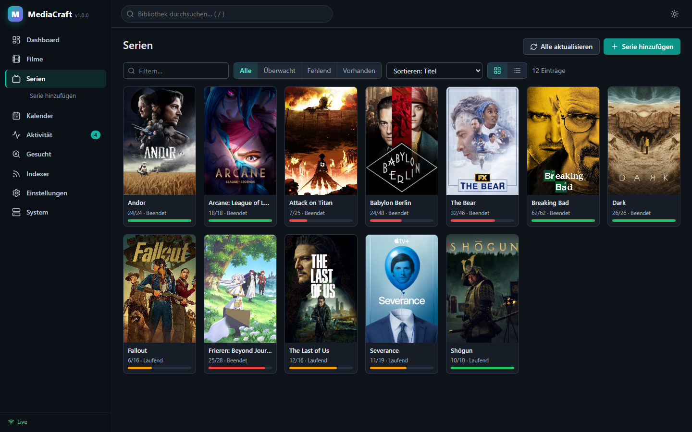<br><sub><b>Serien</b>: Poster-Ansicht mit Fortschritt pro Serie</sub></td>
    <td width="50%">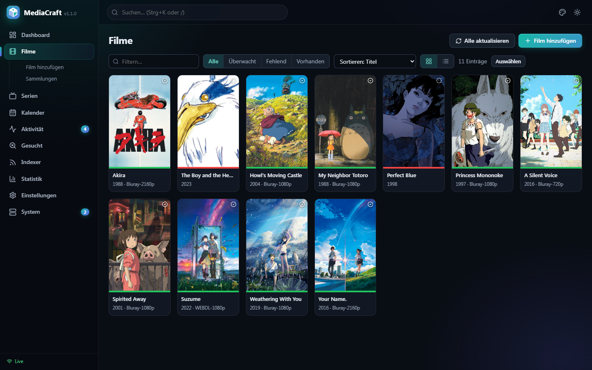<br><sub><b>Filme</b>: Filter, Sortierung, Qualität auf einen Blick</sub></td>
  </tr>
  <tr>
    <td>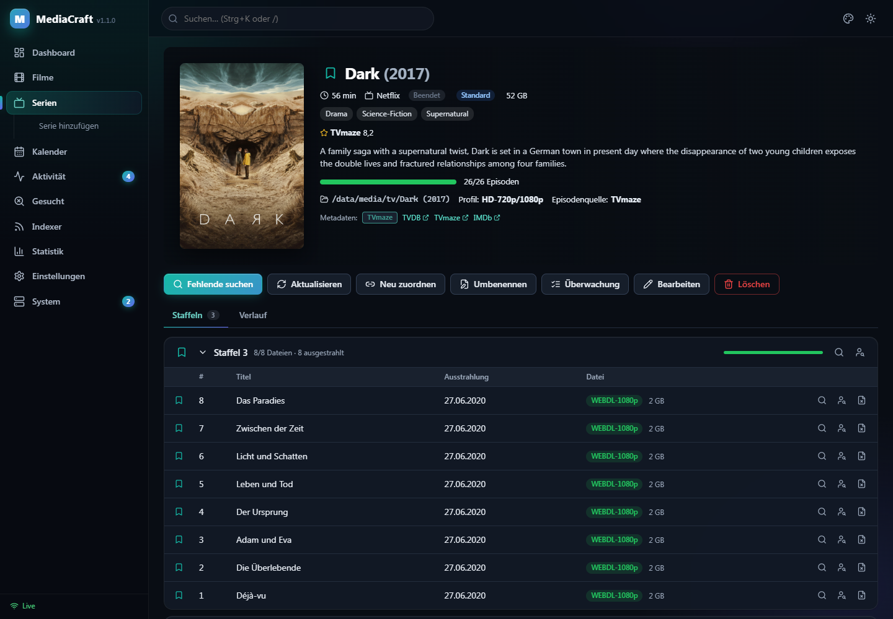<br><sub><b>Seriendetails</b>: Staffeln, Episoden, Dateien, Metadatenquellen</sub></td>
    <td>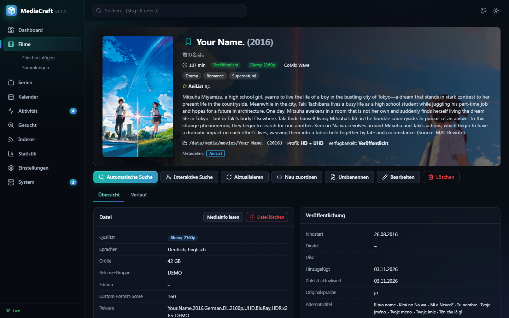<br><sub><b>Filmdetails</b>: Datei, Sprachen, Custom-Format-Score</sub></td>
  </tr>
  <tr>
    <td>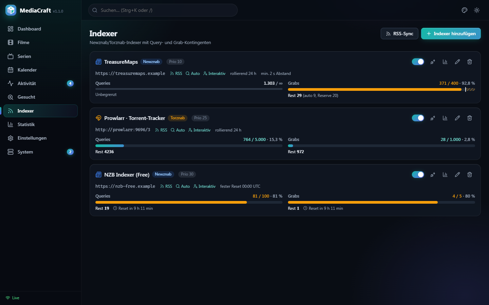<br><sub><b>Indexer</b>: rollierende und feste Limits mit Reserve</sub></td>
    <td>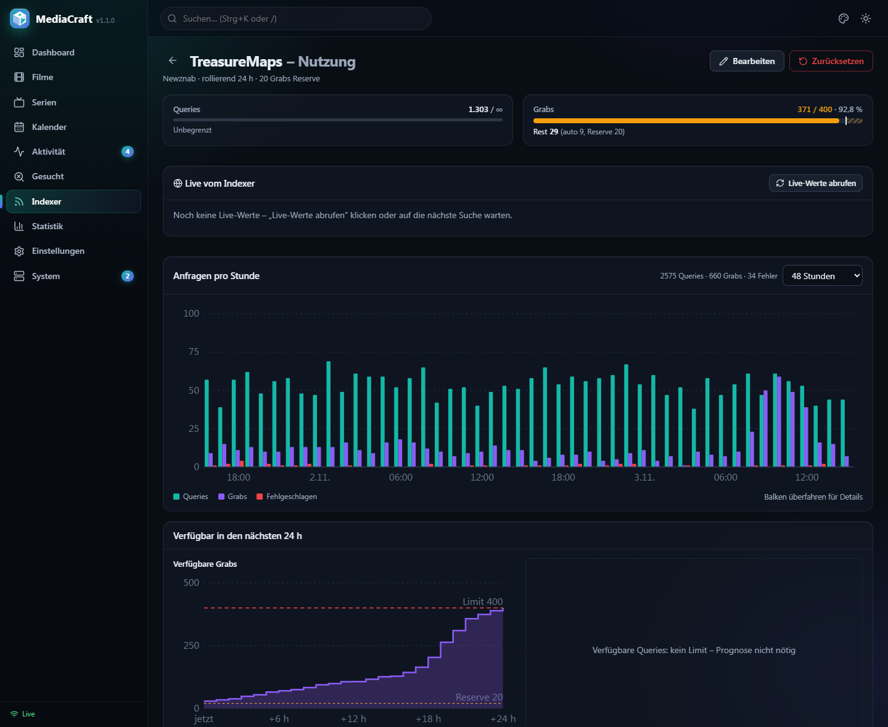<br><sub><b>Indexer-Nutzung</b>: 48-h-Historie und Prognose der freien Grabs</sub></td>
  </tr>
  <tr>
    <td>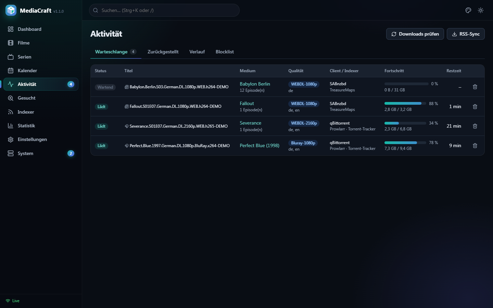<br><sub><b>Aktivität</b>: Warteschlange über alle Downloadclients</sub></td>
    <td>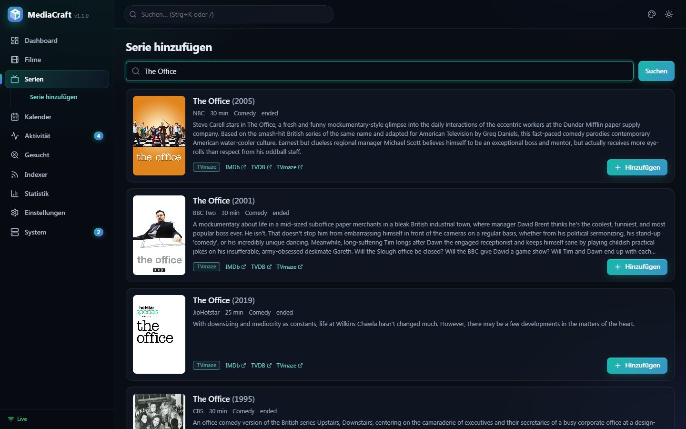<br><sub><b>Serie hinzufügen</b>: Suche über mehrere Provider</sub></td>
  </tr>
  <tr>
    <td>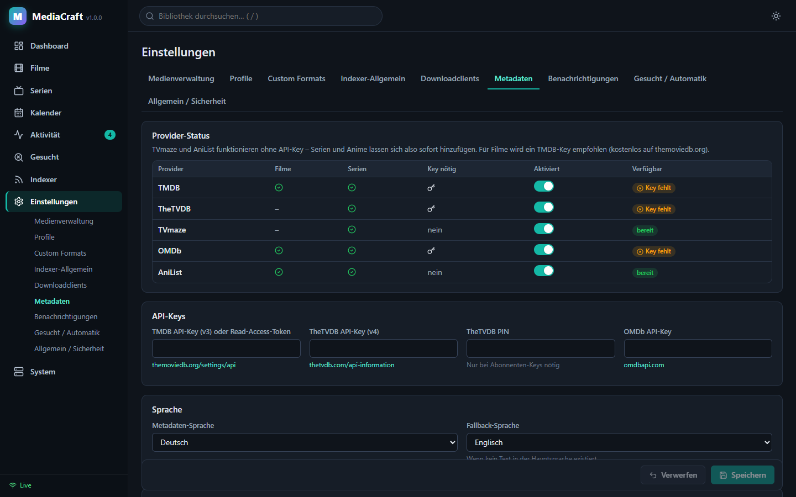<br><sub><b>Metadaten</b>: Provider-Status, Keys, Sprache, Reihenfolge</sub></td>
    <td>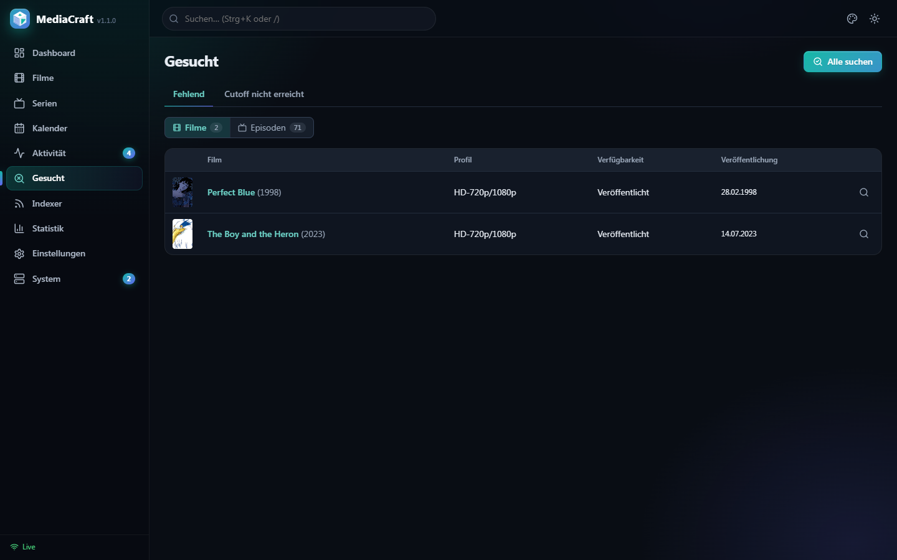<br><sub><b>Gesucht</b>: fehlende Filme/Episoden und Cutoff-Upgrades</sub></td>
  </tr>
</table>

## Installation

Das Image wird bei jedem Push auf `main` automatisch gebaut und für **amd64** und **arm64** veröffentlicht:

```
ghcr.io/gottschalkfelix4-source/mediacraft:latest
```

Nach dem Start ist die Oberfläche unter `http://<host>:7979` erreichbar. Den API-Key findest du unter
*Einstellungen → Allgemein / Sicherheit* oder in `/config/config.json`.

> [!IMPORTANT]
> **Hardlinks:** Downloads und Bibliothek müssen im **selben** Mount liegen, z. B. `/data/torrents`,
> `/data/usenet` und `/data/media/{movies,tv}`, und der Downloadclient muss denselben Pfad `/data` sehen.
> Sonst muss MediaCraft jede Datei kopieren.

### Docker Compose

```yaml
services:
  mediacraft:
    image: ghcr.io/gottschalkfelix4-source/mediacraft:latest
    container_name: mediacraft
    restart: unless-stopped
    environment:
      - PUID=1000
      - PGID=1000
      - UMASK=002
      - TZ=Europe/Berlin
    volumes:
      - ./config:/config
      - /pfad/zu/data:/data
    ports:
      - "7979:7979"
```

```bash
docker compose up -d
```

[docker-compose.yml](docker-compose.yml) enthält die Netzwerk-Einbindung, [docker-compose.stack-example.yml](docker-compose.stack-example.yml)
einen kompletten Stack mit qBittorrent, SABnzbd, Prowlarr, Jellyseerr und Jellyfin.

### Docker CLI

```bash
docker run -d --name mediacraft -p 7979:7979 -e PUID=1000 -e PGID=1000 -e TZ=Europe/Berlin -v /pfad/zu/config:/config -v /pfad/zu/data:/data --restart unless-stopped ghcr.io/gottschalkfelix4-source/mediacraft:latest
```

### Unraid

Das Template mit einem Befehl im Unraid-Terminal (*Tools → Terminal* oder SSH) hinzufügen:

```bash
wget -qO /boot/config/plugins/dockerMan/templates-user/my-MediaCraft.xml https://raw.githubusercontent.com/gottschalkfelix4-source/mediacraft/main/unraid/mediacraft.xml
```

Danach unter *Docker → Container hinzufügen* im Feld *Vorlage* unter **Benutzervorlagen** den Eintrag **MediaCraft** wählen.
Das Template ist auf die Unraid-Standards vorbelegt:

| Feld | Vorgabe |
|---|---|
| WebUI-Port | `7979` |
| Config | `/mnt/user/appdata/mediacraft` → `/config` |
| Data | `/mnt/user/data` → `/data` |
| PUID / PGID | `99` / `100` (nobody:users) |
| UMASK / TZ | `002` / `Europe/Berlin` |

## In einen bestehenden Mediastack integrieren

1. **Netzwerk:** den Container ins vorhandene Docker-Netz hängen (`networks: … external: true`).
2. **Downloadclients:** unter *Einstellungen → Downloadclients* qBittorrent oder SABnzbd mit den Kategorien
   `movies` und `tv` anlegen. Sehen Client und MediaCraft unterschiedliche Pfade, eine Remote-Path-Mapping anlegen.
3. **Prowlarr:** unter *Settings → Apps* zwei Apps mit dem MediaCraft-API-Key anlegen.

   | App | Prowlarr Server | MediaCraft Server |
   |---|---|---|
   | Sonarr | `http://prowlarr:9696` | `http://mediacraft:7979/sonarr` |
   | Radarr | `http://prowlarr:9696` | `http://mediacraft:7979/radarr` |

   Die Indexer werden automatisch synchronisiert. Pusht Prowlarr denselben Indexer für beide Apps,
   führt MediaCraft ihn zu **einem** Indexer zusammen, damit das Limit gemeinsam gezählt wird.
   Die Limits, z. B. 400 Grabs / 24 h, danach in MediaCraft beim Indexer eintragen.
4. **Jellyseerr / Overseerr:** zwei Server mit dem MediaCraft-API-Key anlegen. Profile und Root-Folder werden normal abgefragt.

   | Typ | Host | Port | URL-Base |
   |---|---|---|---|
   | Radarr | `mediacraft` | `7979` | `/radarr` |
   | Sonarr | `mediacraft` | `7979` | `/sonarr` |

5. **Homepage-Widgets:** Typ `sonarr` mit `http://mediacraft:7979/sonarr`, Typ `radarr` mit `http://mediacraft:7979/radarr`, jeweils mit dem MediaCraft-API-Key.
6. **Jellyfin/Emby/Plex:** unter *Einstellungen → Benachrichtigungen* einen Library-Refresh nach jedem Import einrichten.
   **Bazarr:** als Sonarr `mediacraft:7979` mit Basis `/sonarr` und als Radarr mit Basis `/radarr` eintragen, jeweils mit dem MediaCraft-API-Key.
   **Recyclarr:** `base_url: http://mediacraft:7979/sonarr` bzw. `/radarr` und den MediaCraft-API-Key verwenden.
7. **Bestehende Bibliothek übernehmen:** *System → Bibliotheksimport* wählt einen Root-Folder und schlägt für jeden Ordner
   einen Treffer vor, auch über `{tmdb-123}`- und `[tvdbid-123]`-Tags. Der anschließende Disk-Scan verknüpft die vorhandenen Dateien.

## Indexer-Limits einrichten (Beispiel TreasureMaps)

*Indexer → bearbeiten → Limits*:

- Die Vorlage **„TreasureMaps-Stil: 400 Grabs / 24 h rollierend“** wählen.
  Von Hand geht es auch: `grab_limit=400`, Fenster `24 h`, Modus `rollierend`.
- Optional `grab_reserve` setzen, z. B. 20. Automatische Suchen hören dann bei 380 auf,
  die restlichen 20 bleiben für interaktive Grabs.
- Optional `query_limit` und `min_request_interval` setzen, z. B. 2 s.
- **Indexer-Zähler übernehmen** aktiv lassen. MediaCraft fragt die Live-Werte des Indexers (`newznab:apilimits`) alle 15 Minuten ab. Das kostet einen API-Aufruf, nie einen Grab, und wird übersprungen, wenn eine normale Suche die Werte schon frisch geliefert hat. Als Verbrauch zählt der Wert des Indexers plus die eigenen Grabs seit dieser Meldung. So werden auch Grabs von anderen Tools oder von der Website berücksichtigt.
- Unter *Indexer → Nutzung* zeigt die Karte **„Live vom Indexer“** die gemeldeten Werte samt Rohdaten. Mit **„Live-Werte abrufen“** lassen sie sich jederzeit neu holen.

*Rollierend* bedeutet: Gezählt werden alle Grabs der letzten 24 Stunden. Ein Slot wird genau 24 h nach dem
jeweiligen Grab wieder frei. Die Nutzungsseite zeigt deshalb eine Prognose, wie viele Grabs in den nächsten
Stunden wieder verfügbar werden. Fehlgeschlagene Grabs zählen nicht, fehlgeschlagene Queries schon.

## Konfiguration

| Variable | Standard | Bedeutung |
|---|---|---|
| `PUID` / `PGID` | `1000` / `1000` | Benutzer und Gruppe, unter denen MediaCraft läuft |
| `UMASK` | `002` | Rechte neuer Dateien |
| `TZ` | `Europe/Berlin` | Zeitzone |
| `MEDIACRAFT_PORT` | `7979` | Port |
| `MEDIACRAFT_API_KEY` | generiert | festen API-Key setzen |
| `MEDIACRAFT_URL_BASE` | leer | Unterpfad hinter einem Reverse-Proxy, z. B. `/mediacraft` |

| Volume | Inhalt |
|---|---|
| `/config` | Datenbank (SQLite), Logs und `config.json` |
| `/data` | Downloads und Bibliothek |

Hinter einem Reverse-Proxy läuft MediaCraft unter einer eigenen Subdomain (z. B. `mediacraft.example.de`) oder unter
einem Unterpfad: dafür `MEDIACRAFT_URL_BASE=/mediacraft` setzen und den Pfad im Proxy **nicht** abschneiden.
Die Sonarr-/Radarr-APIs liegen dann unter `/mediacraft/sonarr` bzw. `/mediacraft/radarr`.

Ohne API-Keys funktionieren Serien (TVmaze) und Anime (AniList) sofort. Für normale Filme einen kostenlosen
[TMDB-Key](https://www.themoviedb.org/settings/api) unter *Einstellungen → Metadaten* eintragen.

## Entwicklung

```bash
# Backend (FastAPI, Python 3.12)
cd backend
python -m venv .venv && .venv/bin/pip install -r requirements.txt pytest ruff   # Windows: .venv/Scripts/pip
MEDIACRAFT_CONFIG_DIR=./config .venv/bin/python -m app.main                # http://localhost:7979, API-Doku unter /api/docs
.venv/bin/python -m pytest -q
.venv/bin/ruff check app tests

# Frontend (React + Vite, Proxy auf :7979)
cd frontend && npm install && npm run dev
npm test          # Vitest

# Image lokal bauen
docker build -t mediacraft:dev .
```

```
backend/app/
  core/            Parser, Qualitäten, Custom Formats, Entscheidungs-Engine, Scheduler
  metadata/        TMDB, TVDB, TVmaze, OMDb, AniList und der Manager für Merge und Priorität
  indexers/        Newznab/Torznab-Client und Usage-Tracking
  downloadclients/ qBittorrent, Transmission, Deluge, SABnzbd, NZBGet, Blackhole
  services/        Bibliothek, Suche, Grab, Queue, Import, RSS, Wartung
  api/             REST-API /api/v1 und Sonarr-/Radarr-Kompatibilität
frontend/src/      React-SPA
unraid/            Unraid-Template und Icon
```

---

<sub>Die Screenshots zeigen eine Demo-Installation mit simulierten Indexern, Downloads und Dateien.
Metadaten und Poster stammen von TVmaze und AniList. MediaCraft steht in keiner Verbindung zu Sonarr, Radarr oder TreasureMaps.</sub>
