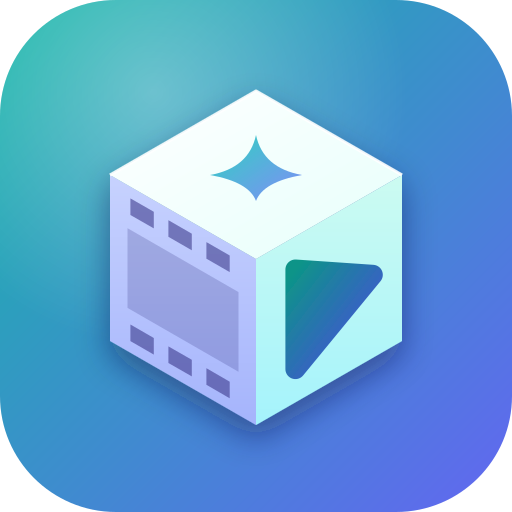
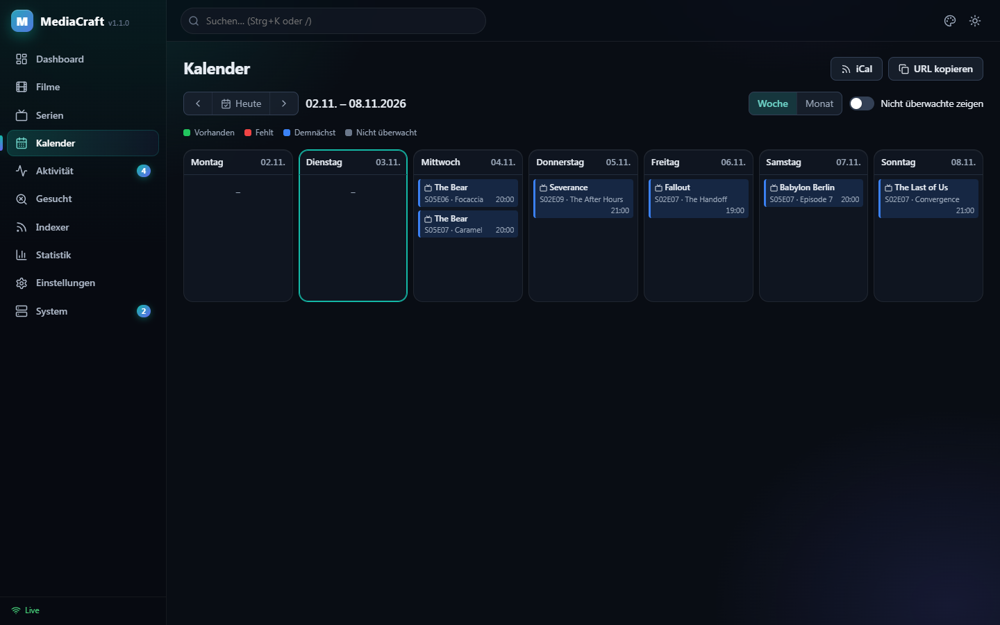
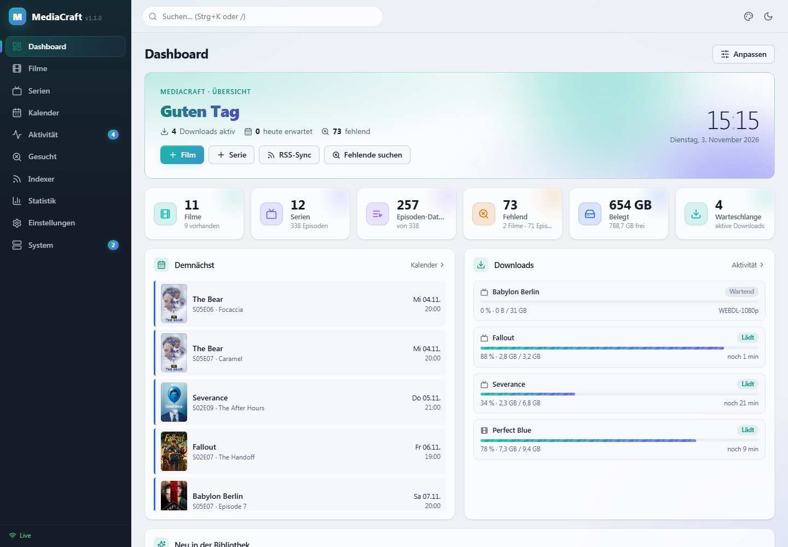

<p align="center">
  
</p>

<h1 align="center">MediaCraft</h1>

<p align="center">
  <b>Filme, Serien und Anime in einer Anwendung.</b><br>
  Automatische Suche, Download und Verwaltung deiner Mediathek in einem einzigen Docker-Container –<br>
  mit mehreren Metadaten-Providern und einem Indexer-Tracking, das Grab-Limits zuverlässig einhält.
</p>

<p align="center">
  <a href="https://github.com/gottschalkfelix4-source/mediacraft/actions/workflows/docker.yml"></a>
  <a href="https://github.com/gottschalkfelix4-source/mediacraft/pkgs/container/mediacraft"></a>
  <a href="LICENSE"></a>
  
  
</p>

<p align="center">
  
</p>

MediaCraft übernimmt die Aufgaben von Sonarr und Radarr in **einer** Oberfläche: Filme und Serien hinzufügen,
neue Folgen und Releases automatisch finden, an den Downloadclient übergeben, nach dem Download importieren,
umbenennen und bei besserer Qualität ersetzen. Bibliothek, Profile, Indexer und Downloadclients werden dabei
gemeinsam genutzt, statt doppelt gepflegt zu werden.

Der Code ist eine eigenständige Neuentwicklung. Über eine Sonarr-/Radarr-kompatible API lässt sich MediaCraft
trotzdem ohne Umbau in bestehende Setups mit Prowlarr, Jellyseerr/Overseerr, Bazarr, Recyclarr und Homepage einbinden.

## Inhalt

- [Funktionen](#funktionen)
- [Screenshots](#screenshots)
- [Installation](#installation)
  - [Docker Compose](#docker-compose)
  - [Docker CLI](#docker-cli)
  - [Unraid](#unraid)
- [Ersteinrichtung](#ersteinrichtung)
- [In einen bestehenden Mediastack integrieren](#in-einen-bestehenden-mediastack-integrieren)
- [Indexer-Limits einrichten](#indexer-limits-einrichten)
- [Konfiguration](#konfiguration)
- [Updates und Backups](#updates-und-backups)
- [Entwicklung](#entwicklung)
- [Lizenz](#lizenz)

## Funktionen

### Bibliothek

- Filme, Serien und Anime in einer gemeinsamen Datenbank mit gemeinsamen Profilen, Tags und Root-Foldern
- Poster- und Listenansicht mit Filtern, Sortierung und Fortschritt pro Serie und Staffel
- Kalender mit Wochen- und Monatsansicht sowie iCal-Feed für Kalender-Apps
- **Gesucht**: fehlende Filme und Episoden sowie Releases unterhalb des Qualitäts-Cutoffs
- Filmsammlungen aus TMDB mit fehlenden Teilen, einzeln oder komplett hinzufügbar
- Massen-Editor für Profil, Root-Folder (Dateien werden mitverschoben), Tags, Überwachung, Suche und Löschen
- Import vorhandener Bibliotheken mit automatischer Zuordnung, auch über `{tmdb-123}`- und `[tvdbid-123]`-Ordnertags
- Import-Listen: TMDB-Listen, -Sammlungen und -Charts, Trakt, IMDb-Listen, Plex-Watchlist und eigene JSON-URLs

### Metadaten

- **TMDB**, **TheTVDB v4**, **TVmaze**, **OMDb** und **AniList** – mit einstellbarer Reihenfolge pro Medientyp
- Die Suche fragt alle aktiven Provider parallel ab und führt Treffer über ihre IDs (tvdb/tmdb/imdb/tvmaze/anilist) zusammen
- Fehlende Felder werden aus weiteren Providern ergänzt: deutsche Titel und Beschreibungen, Poster, Bewertungen, Alternativtitel, Ausstrahlungszeiten
- Ohne API-Key sofort nutzbar: TVmaze für Serien, AniList für Anime
- Pro Serie wählbar, welcher Provider die Episodennummerierung vorgibt

### Indexer und Limits

- Newznab und Torznab mit Caps-Erkennung, ID-Suche vor Textsuche und RSS-Sync
- **Query- und Grab-Limits pro Indexer**, rollierend (z. B. 400 Grabs in 24 h) oder mit festem Reset-Zeitpunkt
- Reserve für manuelle Grabs und Mindestabstand zwischen Anfragen
- Übernahme der Live-Zähler aus `newznab:apilimits`, damit Zugriffe anderer Tools mitgezählt werden
- Automatische Pause bei Limit-Fehlern (500/501/429) bis zum nächsten freien Slot
- Nutzungsseite mit 48-Stunden-Historie und Prognose der wieder verfügbaren Grabs
- Filme und Serien teilen sich einen Zähler pro Indexer; sparsame Suche mit einer Staffel-Query statt vieler Einzelfolgen

### Qualität und Releases

- Qualitätsprofile mit Cutoff und automatischen Upgrades inklusive Proper/Repack
- Custom Formats mit Punktwertung, vorkonfiguriert u. a. für German DL, German, HDR, Dolby Vision, Atmos, x265 und LQ-Gruppen
- Sprache als Pflicht oder Präferenz; der Parser erkennt `German.DL`, `ML` und `Subbed`
- Pflicht- und Ausschlussbegriffe, Größenlimits pro Minute, Seeder-Minimum, Retention und Mindestalter
- Delay-Profile, z. B. zwei Stunden auf ein German-DL-Release warten oder Usenet bevorzugen
- Release-Parser für Scene-, P2P- und Anime-Namen: Staffelpakete, Multi-Episoden, Daily-Shows, absolute Nummerierung
- Interaktive Suche mit Begründung, warum ein Release abgelehnt wurde
- Blocklist für fehlgeschlagene Releases

### Downloads und Import

- **qBittorrent**, **Transmission**, **Deluge**, **SABnzbd**, **NZBGet** sowie Blackhole für Torrent und NZB
- Warteschlange über alle Downloadclients mit Live-Fortschritt
- Automatisches Entpacken von RAR (auch mehrteilig), 7z und ZIP vor dem Import
- Mediainfo-Prüfung: Tonspuren, Codec, Auflösung und HDR werden aus der Datei gelesen – ein als German DL benanntes Release ohne deutsche Tonspur wird erkannt und erneut gesucht
- Hardlinks mit Fallback auf Kopie, Remote-Path-Mappings, Umbenennen nach Vorlage, Untertitel werden mitgenommen
- Papierkorb für ersetzte und gelöschte Dateien mit Wiederherstellung
- Hängende oder fehlgeschlagene Downloads werden erkannt, geblockt und neu gesucht
- Manueller Import für Dateien, die nicht automatisch zugeordnet werden konnten

### Benachrichtigungen

- Discord, Telegram, Gotify, ntfy, Pushover, E-Mail, Apprise und Webhooks (auch im Sonarr-/Radarr-Format)
- Library-Refresh für Jellyfin, Emby und Plex nach jedem Import
- Ereignisse für Grab, Import, Upgrade, fehlgeschlagene Downloads, Löschen, Umbenennen, Health-Probleme und knappes Indexer-Kontingent

### System

- Ein Image für amd64 und arm64 mit PUID/PGID, Healthcheck und Unraid-Template
- Automatische und manuelle Backups mit Wiederherstellung per Klick; vor jedem Datenbank-Update wird gesichert
- Health-Checks, Aufgabenübersicht, Logs, Statistiken und Update-Hinweis mit Änderungsliste
- Live-Aktualisierung der Oberfläche per Server-Sent Events
- Dunkles und helles Design, sechs Akzentfarben, anpassbares Widget-Dashboard
- API-Key, optional Formular-Login mit Sperre nach Fehlversuchen und optional ohne Login im Heimnetz
- Betrieb hinter einem Reverse-Proxy auf eigener Subdomain oder unter einem Unterpfad

## Screenshots

<table>
  <tr>
    <td width="50%"><br><sub><b>Serien</b> – Posteransicht mit Fortschritt pro Serie</sub></td>
    <td width="50%"><br><sub><b>Filme</b> – Filter, Sortierung und Qualität auf einen Blick</sub></td>
  </tr>
  <tr>
    <td><br><sub><b>Seriendetails</b> – Staffeln, Episoden, Dateien und Metadatenquellen</sub></td>
    <td><br><sub><b>Filmdetails</b> – Datei, Tonspuren und Custom-Format-Wertung</sub></td>
  </tr>
  <tr>
    <td><br><sub><b>Kalender</b> – anstehende Folgen und Filme, auch als iCal-Feed</sub></td>
    <td><br><sub><b>Aktivität</b> – Warteschlange über alle Downloadclients</sub></td>
  </tr>
  <tr>
    <td><br><sub><b>Indexer</b> – rollierende und feste Limits mit Reserve</sub></td>
    <td><br><sub><b>Indexer-Nutzung</b> – Historie und Prognose der freien Grabs</sub></td>
  </tr>
  <tr>
    <td><br><sub><b>Serie hinzufügen</b> – Suche über mehrere Provider</sub></td>
    <td><br><sub><b>Gesucht</b> – fehlende Episoden und Cutoff-Upgrades</sub></td>
  </tr>
  <tr>
    <td><br><sub><b>Metadaten</b> – Provider, API-Keys, Sprache und Reihenfolge</sub></td>
    <td><br><sub><b>Helles Design</b> – umschaltbar, mit wählbarer Akzentfarbe</sub></td>
  </tr>
</table>

## Installation

Das Image wird für **amd64** und **arm64** veröffentlicht:

```
ghcr.io/gottschalkfelix4-source/mediacraft:latest
```

Nach dem Start ist die Oberfläche unter `http://<server-ip>:7979` erreichbar.

> [!IMPORTANT]
> **Hardlinks:** Downloads und Bibliothek sollten im **selben** Mount liegen, z. B. `/data/torrents`,
> `/data/usenet` und `/data/media/{movies,tv}`, und der Downloadclient muss denselben Pfad `/data` sehen.
> Andernfalls muss MediaCraft jede Datei kopieren, was doppelten Speicherplatz belegt.

### Docker Compose

```yaml
services:
  mediacraft:
    image: ghcr.io/gottschalkfelix4-source/mediacraft:latest
    container_name: mediacraft
    restart: unless-stopped
    environment:
      - PUID=1000
      - PGID=1000
      - UMASK=002
      - TZ=Europe/Berlin
    volumes:
      - ./config:/config
      - /pfad/zu/data:/data
    ports:
      - "7979:7979"
```

```bash
docker compose up -d
```

Weitere Beispiele:

- [docker-compose.yml](docker-compose.yml) – Einbindung in ein vorhandenes Docker-Netzwerk
- [docker-compose.stack-example.yml](docker-compose.stack-example.yml) – kompletter Stack mit qBittorrent, SABnzbd, Prowlarr, Jellyseerr und Jellyfin

### Docker CLI

```bash
docker run -d \
  --name mediacraft \
  -p 7979:7979 \
  -e PUID=1000 -e PGID=1000 -e TZ=Europe/Berlin \
  -v /pfad/zu/config:/config \
  -v /pfad/zu/data:/data \
  --restart unless-stopped \
  ghcr.io/gottschalkfelix4-source/mediacraft:latest
```

### Unraid

Das Template im Unraid-Terminal (*Tools → Terminal* oder per SSH) hinzufügen:

```bash
wget -qO /boot/config/plugins/dockerMan/templates-user/my-MediaCraft.xml https://raw.githubusercontent.com/gottschalkfelix4-source/mediacraft/main/unraid/mediacraft.xml
```

Anschließend unter *Docker → Container hinzufügen* bei *Vorlage* unter **Benutzervorlagen** den Eintrag
**MediaCraft** auswählen. Die Felder sind mit den Unraid-Standards vorbelegt:

| Feld | Vorgabe |
|---|---|
| WebUI-Port | `7979` |
| Config | `/mnt/user/appdata/mediacraft` → `/config` |
| Data | `/mnt/user/data` → `/data` |
| PUID / PGID | `99` / `100` (nobody:users) |
| UMASK / TZ | `002` / `Europe/Berlin` |

## Ersteinrichtung

1. **Root-Folder anlegen** – unter *Einstellungen → Medienverwaltung* je einen Ordner für Filme und Serien
   hinzufügen, z. B. `/data/media/movies` und `/data/media/tv`.
2. **Downloadclient verbinden** – unter *Einstellungen → Downloadclients* qBittorrent, SABnzbd o. Ä. mit den
   Kategorien `movies` und `tv` eintragen. Sehen Client und MediaCraft unterschiedliche Pfade, ein
   Remote-Path-Mapping anlegen.
3. **Indexer hinzufügen** – direkt unter *Indexer* oder automatisch über Prowlarr
   (siehe [Integration](#in-einen-bestehenden-mediastack-integrieren)).
4. **Metadaten** – Serien und Anime funktionieren sofort. Für Filme unter *Einstellungen → Metadaten* einen
   kostenlosen [TMDB-API-Key](https://www.themoviedb.org/settings/api) eintragen.
5. **Absichern** – unter *Einstellungen → Allgemein / Sicherheit* den Formular-Login aktivieren, falls MediaCraft
   von außen erreichbar ist. Dort steht auch der API-Key für andere Anwendungen.

Danach lassen sich über *Filme → Film hinzufügen* bzw. *Serien → Serie hinzufügen* die ersten Titel anlegen,
oder eine vorhandene Sammlung über *System → Bibliotheksimport* übernehmen.

## In einen bestehenden Mediastack integrieren

MediaCraft stellt unter `/sonarr` und `/radarr` je eine kompatible API bereit. Andere Anwendungen werden wie für
Sonarr bzw. Radarr eingerichtet, jeweils mit dem MediaCraft-API-Key.

**Prowlarr** – unter *Settings → Apps* zwei Apps anlegen:

| App | Prowlarr Server | MediaCraft Server |
|---|---|---|
| Sonarr | `http://prowlarr:9696` | `http://mediacraft:7979/sonarr` |
| Radarr | `http://prowlarr:9696` | `http://mediacraft:7979/radarr` |

Die Indexer werden automatisch synchronisiert. Wird derselbe Indexer für beide Apps übertragen, führt
MediaCraft ihn zu einem Eintrag zusammen, damit das Limit gemeinsam gezählt wird.

**Jellyseerr / Overseerr** – zwei Server anlegen:

| Typ | Host | Port | URL-Base |
|---|---|---|---|
| Radarr | `mediacraft` | `7979` | `/radarr` |
| Sonarr | `mediacraft` | `7979` | `/sonarr` |

**Weitere Anwendungen**

| Anwendung | Einrichtung |
|---|---|
| Homepage | Widget-Typ `sonarr` mit `http://mediacraft:7979/sonarr`, Typ `radarr` mit `http://mediacraft:7979/radarr` |
| Bazarr | Sonarr: `mediacraft:7979`, Basis `/sonarr` · Radarr: `mediacraft:7979`, Basis `/radarr` |
| Recyclarr | `base_url: http://mediacraft:7979/sonarr` bzw. `/radarr` |
| Jellyfin / Emby / Plex | unter *Einstellungen → Benachrichtigungen* einen Library-Refresh nach jedem Import einrichten |

## Indexer-Limits einrichten

Viele private Usenet-Indexer begrenzen die Zahl der Downloads pro Tag. MediaCraft zählt jede Anfrage und jeden
Grab mit und hält das Limit ein, bevor der Indexer ablehnt. Am Beispiel eines Indexers mit 400 Grabs in 24 Stunden
(rollierend), unter *Indexer → Bearbeiten → Limits*:

- Die Vorlage **„TreasureMaps-Stil: 400 Grabs / 24 h rollierend“** wählen oder von Hand `Grab-Limit = 400`, Fenster `24 h`, Modus `rollierend` setzen.
- Optional eine **Reserve** setzen, z. B. 20: automatische Suchen stoppen dann bei 380, die restlichen 20 bleiben für manuelle Grabs.
- Optional ein Query-Limit und einen Mindestabstand zwischen Anfragen, z. B. 2 Sekunden.
- **Indexer-Zähler übernehmen** aktiv lassen. MediaCraft liest dann die Live-Werte aus `newznab:apilimits`, sodass auch
  Downloads über die Website oder andere Tools mitzählen. Die Abfrage kostet nur einen API-Aufruf, nie einen Grab.

*Rollierend* bedeutet: Gezählt werden alle Grabs der letzten 24 Stunden, und ein Slot wird genau 24 Stunden nach dem
jeweiligen Grab wieder frei. Die Nutzungsseite zeigt deshalb eine Prognose, wie viele Grabs in den nächsten Stunden
wieder verfügbar werden. Fehlgeschlagene Grabs zählen nicht.

## Konfiguration

| Variable | Standard | Bedeutung |
|---|---|---|
| `PUID` / `PGID` | `1000` / `1000` | Benutzer und Gruppe, unter denen MediaCraft läuft |
| `UMASK` | `002` | Rechte neu angelegter Dateien |
| `TZ` | `Europe/Berlin` | Zeitzone |
| `MEDIACRAFT_PORT` | `7979` | Port der Oberfläche und API |
| `MEDIACRAFT_API_KEY` | wird generiert | festen API-Key vorgeben |
| `MEDIACRAFT_URL_BASE` | leer | Unterpfad hinter einem Reverse-Proxy, z. B. `/mediacraft` |

| Volume | Inhalt |
|---|---|
| `/config` | Datenbank (SQLite), Logs, Backups und `config.json` |
| `/data` | Downloads und Bibliothek |

**Reverse-Proxy:** MediaCraft läuft entweder auf einer eigenen Subdomain (z. B. `mediacraft.example.de`) oder unter
einem Unterpfad. Für einen Unterpfad `MEDIACRAFT_URL_BASE=/mediacraft` setzen und den Pfad im Proxy **nicht**
entfernen. Die kompatiblen APIs liegen dann unter `/mediacraft/sonarr` bzw. `/mediacraft/radarr`.

## Updates und Backups

```bash
docker compose pull && docker compose up -d
```

Unter *System → Updates* zeigt MediaCraft an, ob eine neuere Version verfügbar ist und was sich geändert hat.
Vor jeder Änderung am Datenbankschema wird automatisch ein Backup erstellt. Backups liegen in `/config/backups`
und lassen sich unter *System → Backup* erstellen, herunterladen und wiederherstellen.

## Entwicklung

**Backend** (Python 3.12, FastAPI, SQLAlchemy):

```bash
cd backend
python -m venv .venv
.venv/bin/pip install -r requirements.txt pytest ruff        # Windows: .venv\Scripts\pip
MEDIACRAFT_CONFIG_DIR=./config .venv/bin/python -m app.main  # http://localhost:7979, API-Doku unter /api/docs
.venv/bin/python -m pytest -q
.venv/bin/ruff check app tests
```

**Frontend** (React 18, TypeScript, Vite) mit Proxy auf das Backend:

```bash
cd frontend
npm install
npm run dev
npm test
```

**Image lokal bauen:**

```bash
docker build -t mediacraft:dev .
```

Projektaufbau:

```
backend/app/
  core/             Release-Parser, Qualitäten, Custom Formats, Entscheidungs-Engine, Scheduler
  metadata/         TMDB, TheTVDB, TVmaze, OMDb, AniList und Zusammenführung
  indexers/         Newznab/Torznab-Client und Limit-Tracking
  downloadclients/  Torrent- und Usenet-Clients, Blackhole
  services/         Bibliothek, Suche, Grab, Warteschlange, Import, RSS, Backups, Benachrichtigungen
  api/              REST-API unter /api/v1 und Sonarr-/Radarr-kompatible Schnittstelle
frontend/src/       Weboberfläche (React)
unraid/             Unraid-Template und Icon
```

Eine ausführlichere Beschreibung der Architektur steht in [docs/architektur.md](docs/architektur.md).

## Lizenz

MediaCraft steht unter der [GNU General Public License v3.0](LICENSE).

---

<sub>Die Screenshots zeigen eine Demo-Installation mit simulierten Indexern, Downloads und Dateien; Metadaten und Poster
stammen von TVmaze und AniList. MediaCraft ist ein unabhängiges Projekt und steht in keiner Verbindung zu
Sonarr, Radarr oder den genannten Indexern und Diensten.</sub>
